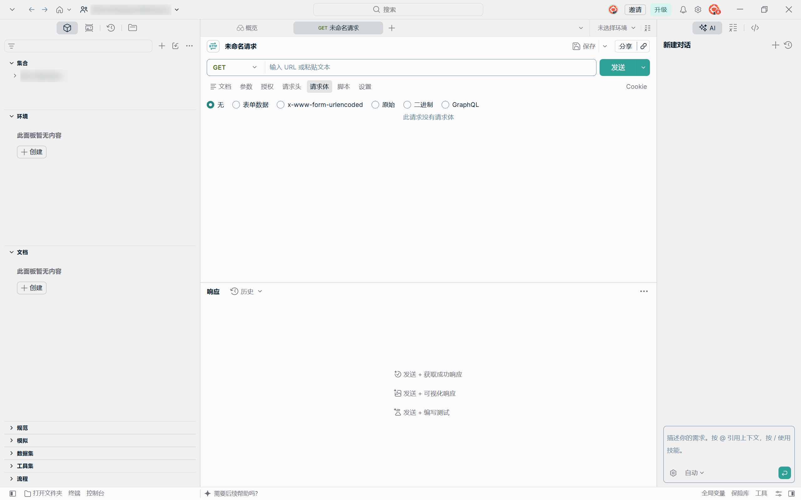
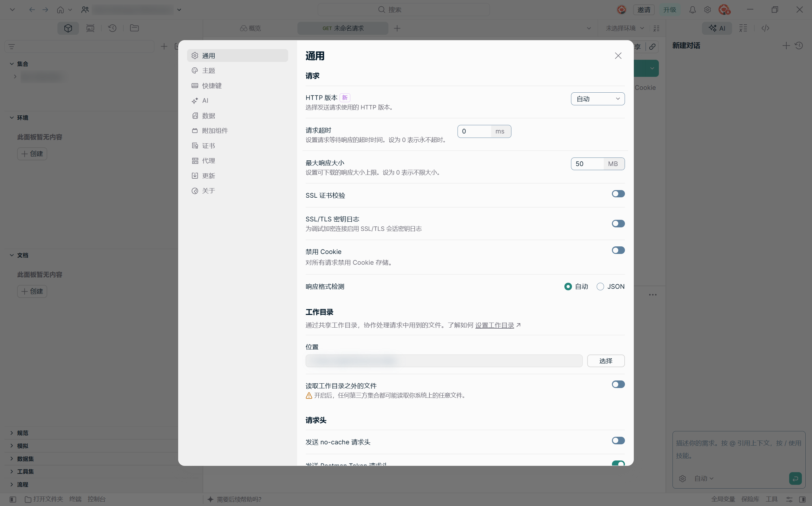

# postman-zh-cn

给 **Postman 桌面版** 用的简体中文界面补丁。不降级、不改版本、不动你的集合与环境数据，随时可一键还原。

> 非官方项目，与 Postman, Inc. 无关。仓库内不含任何 Postman 程序文件。





## 为什么需要它

- Postman 没有官方中文。应用内其实带了一套基于 `i18next` 的 i18n 框架（`platform-libs/i18n-sdk`），但语言资源走云端且**没有 `zh-Hans`**，所以调不出中文。
- 社区最常用的 [Postman-cn](https://github.com/hlmd/Postman-cn) 最后停在 **9.12.2**，对 11/12 版本无效。
- Postman 12 的界面是从 `desktop.postman.com` 加载的**远程 Web 应用**（Module Federation），改 `resources/app.asar` 里 `html/*.html` 里的文案不会生效。

## 原理

Postman 每个窗口在创建时都会加载 `resources/app.asar` 里的 preload 脚本（`preload_desktop.js` / `preload.js`，且 `contextIsolation: false`）。preload 在页面脚本之前执行、又能访问 DOM，因此对远程页面同样有效。

本补丁做三件事：

1. 把翻译层追加到上述 preload 脚本末尾；
2. 翻译层用 **MutationObserver + TreeWalker** 扫描 DOM 文本节点，按「完整文本」精确匹配词典后替换；
3. 重新打包 `app.asar`（原文件备份为 `app.asar.pmcn-backup`）。

安全性上的取舍：

| 处理 | 说明 |
| --- | --- |
| 只替换**完整匹配**的文本 | `Send` 会翻译，`Send request` 这种拼接句不会被误伤 |
| 跳过 `input` / `textarea` / 代码编辑器 / `[contenteditable]` | 请求体、脚本、JSON 内容不会被改 |
| 不翻译用户数据 | 集合名、工作区名、环境名保持原样 |
| 保留术语 | `GET`、`Cookie`、`GraphQL`、`x-www-form-urlencoded` 等开发术语不译 |
| 完全离线 | 不联网、不上报，只在本地改页面文案 |

## 环境要求

- Windows（PowerShell 5.1+）
- Postman 桌面版 12.x（在 **12.36.1** 上验证）
- [Node.js](https://nodejs.org/)（用于重新打包 `app.asar`）

## 使用

```powershell
git clone https://github.com/ashtondebug/postman-zh-cn.git
cd postman-zh-cn\patcher
.\install.ps1
```

脚本会：找到当前 Postman 版本目录 → 备份原始 `app.asar` → 注入翻译层并重新打包 → 重启 Postman。

其他操作：

| 场景 | 做法 |
| --- | --- |
| 临时对照英文 | 在 Postman 窗口按 `Ctrl+Alt+Z`，再按一次恢复 |
| 彻底还原 | `.\restore.ps1` |
| Postman 升级后失效 | 升级会写入新的 `app-<版本>` 目录，重新跑一次 `.\install.ps1` |

> 如果 PowerShell 禁止运行脚本，先执行：`Set-ExecutionPolicy -Scope Process Bypass`

## 覆盖范围

已中文化：

- 工作区总览、顶部搜索、邀请 / 升级
- 左侧栏：集合、环境、文档、规范、模拟、数据集、工具集、流程
- 请求编辑器：文档 / 参数 / 授权 / 请求头 / 请求体 / 脚本 / 设置，发送、保存、分享
- 查询参数表头（键 / 值 / 描述 / 批量编辑）、请求体类型（无 / 表单数据 / 原始 / 二进制 / GraphQL）
- 响应区、AI 面板、底部状态栏、各类悬浮提示与 `aria-label`
- 完整设置面板：通用 / 主题 / 快捷键 / AI / 数据 / 附加组件 / 证书 / 代理 / 更新 / 关于（含每项说明文字）

保持英文：HTTP 方法、`Cookie` 等通用术语、版本号等技术值，以及你自己的集合 / 工作区名称。

## 参与翻译

词典在 `patcher/dict.json`（键为界面原文，值为译文）。改完后重新生成并应用：

```powershell
cd patcher
node build.js        # 由 dict.json + pm-cn.template.js 重新生成 pm-cn.js
.\install.ps1        # 注入到本机 Postman 并重启
```

`install.ps1` 会从 `pm-cn.js` 打包，所以改完词典必须先跑 `build.js`。

想找漏翻的文案，在 Postman 里按 `Ctrl+Shift+I` 打开 DevTools，或在页面控制台执行：

```js
[...document.querySelectorAll('*')].filter(e => e.children.length === 0 && /^[A-Za-z][A-Za-z\s.,()/-]{2,60}$/.test(e.textContent.trim()))
  .map(e => e.textContent.trim())
```

把结果里仍是英文的条目补进 `dict.json` 即可。欢迎提 PR，附上截图更好。

## 免责声明

- 本项目是社区汉化，**非官方**，与 Postman, Inc. 没有任何关系。
- 修改的是你自己机器上已安装的 Postman 副本，请确保你有权这样做；升级或校验时 Postman 可能提示文件已被修改，用 `restore.ps1` 可恢复原状。
- 仓库只包含翻译层与打包脚本，不分发 Postman 的任何二进制或资源文件。
- 按 MIT 协议提供，不提供任何担保。

## License

[MIT](LICENSE) © AshtonDebug
